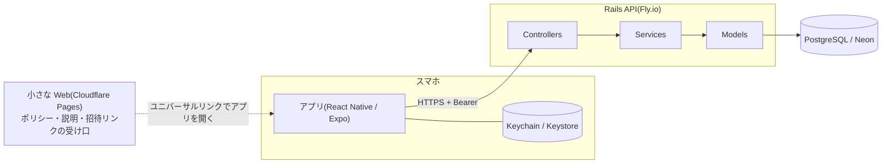
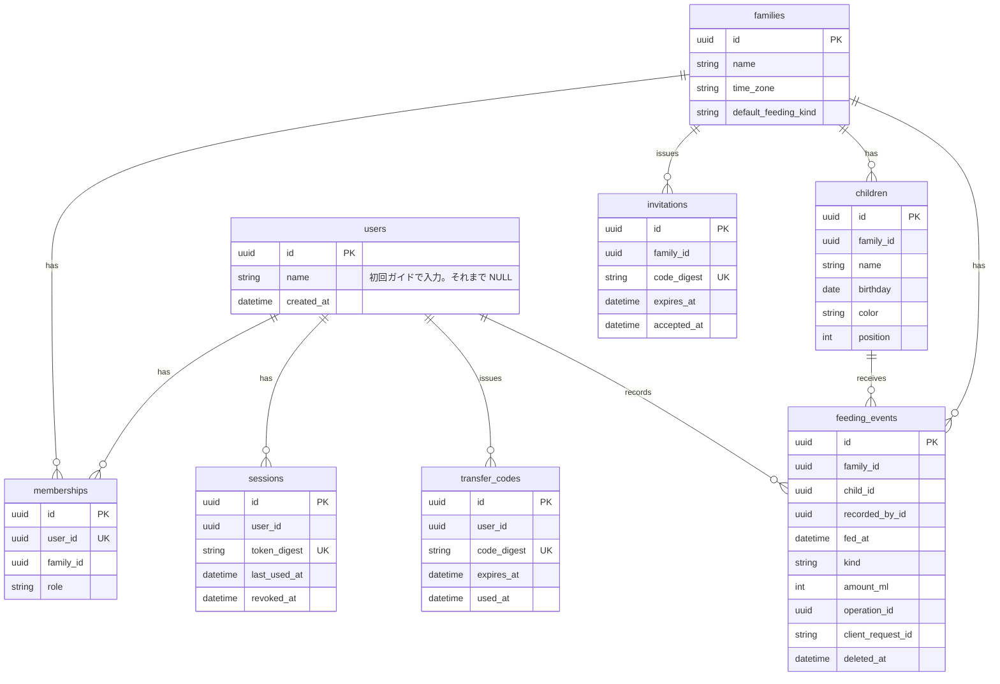

# ゴクゴク 設計書

> **【2026-11-22 方針変更】** クライアントを PWA から React Native(Expo)のアプリに変更した([ADR 0002](adr/0002-react-native.md))。認証は、メールのコードをやめて、登録なしの匿名アカウントにした([ADR 0003](adr/0003-anonymous-account.md))。本書は、この2つを反映済み。


> 版: 0.1(ドラフト) / 対象: MVP
> 要件は [spec.md](spec.md) を参照。要件 ID(F-FEED-7 など)を、各節で対応づけている。

## 1. アーキテクチャ

### 1.1 全体像


| 要素 | 技術 | 役割 |
|---|---|---|
| app | React Native(Expo)/ TypeScript | 画面、トークンの保管、ポーリング、再送 |
| api | Rails 8.1(API mode) | 認証・認可、ドメインロジック、永続化 |
| db | PostgreSQL 17 | 永続化 |
| web | Next.js 16(静的出力) | プライバシーポリシー、説明ページ、招待リンクの受け口(`apple-app-site-association`、`assetlinks.json`) |
| jobs | なし | MVP ではジョブ基盤も、非同期の送信も持たない(4.10) |

### 1.2 主な設計方針
| 方針 | 理由 |
|---|---|
| 認証は `Authorization: Bearer` のみ。Cookie は使わない | クライアントはアプリだけ。CSRF の考慮が要らない。トークンは端末の安全な保管場所に置く |
| 利用者は**匿名**で、メールアドレスを持たない | 初回の操作を最小にし、個人情報を減らす(ADR 0003) |
| API は `/v1` でバージョン管理し、OpenAPI で仕様を持つ | 古いバージョンのアプリが残っても動くようにする。型をアプリ側で生成する |
| 記録は**追記中心**で、取り消しは論理削除にする | 履歴を失わない。競合時の整合を保ちやすい |
| すべてのデータに `family_id` を持たせ、**常に家族で絞り込む** | 他の家族のデータが漏れる事故を構造的に防ぐ |

## 2. データモデル

### 2.1 ER 図


### 2.2 テーブル定義(要点)

主キーはすべて UUID(v7 を想定)とする。連番にしないのは、ID から件数や順序が推測されるのを避けるため。

#### users
| カラム | 型 | 制約 | 備考 |
|---|---|---|---|
| name | string | NULL 可 | 呼び名(履歴の記録者に出す)。**初回ガイドで入力させる**。入力前は NULL で、画面では「あなた」と表示する |

#### families
| カラム | 型 | 制約 | 備考 |
|---|---|---|---|
| name | string | NOT NULL | |
| time_zone | string | NOT NULL, 既定 `Asia/Tokyo` | 履歴の日付区切りに使う |
| default_feeding_kind | string | NOT NULL, 既定 `formula` | F-FEED-3 |

#### memberships
| カラム | 型 | 制約 |
|---|---|---|
| user_id | uuid | NOT NULL, **UNIQUE**(MVP は1家族のみ。F-FAM-5) |
| family_id | uuid | NOT NULL, FK |
| role | string | NOT NULL(`owner` / `member`) |

家族の最大6人は、アプリケーション側で検証する(F-FAM-4)。

#### children
| カラム | 型 | 制約 |
|---|---|---|
| family_id | uuid | NOT NULL, FK |
| name | string | NOT NULL |
| birthday | date | |
| color | string | NOT NULL |
| position | integer | NOT NULL。家族内で UNIQUE |

人数の上限(4人)は、アプリケーション側で検証する(F-CHILD-3)。

#### feeding_events
| カラム | 型 | 制約 | 備考 |
|---|---|---|---|
| family_id | uuid | NOT NULL, FK | 認可と絞り込みのため冗長に持つ |
| child_id | uuid | NOT NULL, FK(ON DELETE CASCADE) | F-CHILD-4 |
| recorded_by_id | uuid | NOT NULL, FK | 利用者が削除されても履歴は残すため、`ON DELETE SET NULL` にして NULL 可とする(「退会したユーザー」と表示) |
| fed_at | timestamptz | NOT NULL | UTC で保存 |
| kind | string | NOT NULL | `formula` / `breast` |
| amount_ml | integer | CHECK 0〜500 | 任意 |
| operation_id | uuid | NOT NULL | 「全員」で記録したときの束ね |
| client_request_id | string | NOT NULL | 冪等性キー(クライアントが生成) |
| deleted_at | timestamptz | | 論理削除 |

インデックス:
- `(family_id, fed_at DESC) WHERE deleted_at IS NULL` ― 履歴の取得
- `(child_id, fed_at DESC) WHERE deleted_at IS NULL` ― 子ごとの前回授乳
- `UNIQUE (family_id, client_request_id, child_id)` ― **冪等性の担保**(論理削除済みも対象)
- `(operation_id)` ― 束ねた取り消し

#### invitations / sessions / transfer_codes
トークンとコードは**平文を保存しない**。セッションのトークン(256ビットの乱数)は SHA-256 のハッシュを保存する。招待コードと引き継ぎコードは、桁数が短く総当たりの余地があるため、**秘密鍵つきの HMAC** を保存する。平文は、API の応答と端末の中にだけ現れる。

| 種類 | 形式 | 推測への強さ |
|---|---|---|
| セッションのトークン | 256ビットの乱数(Base64URL) | 総当たりは不可能 |
| 招待コード | 8文字(紛らわしい文字を除いた32種。約40ビット) | 有効期限、1回限り、回数制限で守る |
| 引き継ぎコード | 12文字(同じ32種。約60ビット) | 同上。家族ではなく利用者そのものを渡すので、招待より長くする |

| テーブル | 有効期限 | 備考 |
|---|---|---|
| transfer_codes | 24時間(F-AUTH-3) | 1回限り。使用時に `used_at` を記録し、その利用者の他のセッションをすべて失効させる。再発行すると古い未使用分を失効させる |
| invitations | 7日(F-FAM-3) | 再発行時に、古い未使用分を失効させる |
| sessions | **時間では切れない**(F-AUTH-2) | 匿名アカウントでは、切れると戻れなくなるため。`revoked_at` で失効させる。`last_used_at` は1日1回だけ更新する(書き込みを減らす) |

## 3. API 設計

### 3.1 共通事項
- ベースパス: `/v1`。アプリから直接呼ぶ(例: `https://api.<ドメイン>/v1/...`)。
- 形式: JSON。時刻は ISO 8601(UTC、`Z` 付き)。
- 認証: `Authorization: Bearer <token>` のみ。Cookie は使わないため、CSRF 対策は不要。ブラウザから呼ばれる想定がないため、CORS も許可しない。
- アプリのバージョンをヘッダー(`X-App-Version`)で送る。対応外の古いバージョンには `426` を返し、更新を促せるようにする。
- エラー形式:
```json
{ "error": { "code": "validation_failed", "message": "…", "details": { "fed_at": ["…"] } } }
```

| HTTP | code の例 | 意味 |
|---|---|---|
| 401 | `unauthenticated` | トークンがない、または失効した |
| 404 | `not_found` | 存在しない、または**他の家族のリソース**(存在を隠す) |
| 422 | `validation_failed` | 入力不正 |
| 429 | `rate_limited` | 回数制限 |

### 3.2 エンドポイント一覧

| メソッド | パス | 要件 | 説明 |
|---|---|---|---|
| POST | `/v1/accounts` | F-AUTH-1 | 匿名の利用者とセッションを作り、トークンを返す(認証不要) |
| POST | `/v1/transfer_codes` | F-AUTH-3 | 引き継ぎコードを発行する |
| POST | `/v1/transfers` | F-AUTH-3 | 引き継ぎコードで、新しい端末のセッションを作る(認証不要) |
| DELETE | `/v1/sessions/others` | F-AUTH-2 | 自分の他の端末のセッションを、すべて失効させる |
| GET | `/v1/me` | | 自分の情報と所属家族 |
| PATCH | `/v1/me` | F-FAM-1 | 呼び名を設定する |
| DELETE | `/v1/me` | F-DATA-1,2 | アカウント削除 |
| POST | `/v1/families` | F-FAM-1 | 家族を作る |
| PATCH | `/v1/family` | F-FEED-3 | 家族の設定(名前、既定の授乳種類) |
| POST | `/v1/family/invitations` | F-FAM-3 | 招待コード(とリンク)を発行 |
| POST | `/v1/invitations/accept` | F-FAM-1〜5 | 招待コードを本文で受け取り、家族に参加する。コードを URL に入れない(ログに残さないため) |
| DELETE | `/v1/family/memberships/:id` | F-FAM-6 | メンバーを外す / 退出する |
| GET | `/v1/children` | | 子ども一覧 |
| POST | `/v1/children` | F-CHILD-1 | 子どもを登録 |
| PATCH | `/v1/children/:id` | F-CHILD-4 | 子どもを更新 |
| DELETE | `/v1/children/:id` | F-CHILD-4 | 子どもを削除 |
| GET | `/v1/dashboard` | F-VIEW-1〜6 | ホームの表示に必要な情報をまとめて返す |
| GET | `/v1/feedings` | F-VIEW-3 | 履歴(カーソル方式) |
| POST | `/v1/feedings` | F-FEED-1〜10 | 授乳を記録する |
| PATCH | `/v1/feedings/:id` | F-FEED-8 | 1件を修正する |
| DELETE | `/v1/feedings/operations/:operation_id` | F-FEED-6 | 操作単位で取り消す |
| DELETE | `/v1/feedings/:id` | F-FEED-8 | 1件だけ削除する |

### 3.3 主要 API の詳細

#### POST /v1/feedings
リクエスト:
```json
{
  "client_request_id": "0198f3c2-…",
  "child_ids": ["…A…", "…B…"],
  "fed_at": "2026-11-15T12:40:03Z",
  "kind": "formula",
  "amount_ml": null
}
```
- `client_request_id`: クライアントが**タップごとに**生成する UUID。同じ操作の再送では同じ値を使う。
- `child_ids`: 1人以上。すべて自分の家族の子どもでなければならない。
- `kind` を省略すると、家族の既定値を使う。

レスポンス(新規作成は **201**、同じ `client_request_id` の再送は **200** で同じ内容):
```json
{
  "operation_id": "…",
  "feedings": [
    { "id": "…", "child_id": "…A…", "fed_at": "…", "kind": "formula", "amount_ml": null,
      "recorded_by": { "id": "…", "name": "パパ" } },
    { "id": "…", "child_id": "…B…", "…": "…" }
  ],
  "warnings": [
    { "code": "possibly_duplicate", "child_id": "…A…",
      "by": { "name": "ママ" }, "seconds_ago": 120 }
  ]
}
```

検証ルール:
| 項目 | ルール |
|---|---|
| `fed_at` | 省略時はサーバー時刻。**サーバー時刻より2分を超えて未来なら 422**。2分以内の未来は、サーバー時刻に丸める(端末の時計のずれの許容)。 |
| `amount_ml` | 0〜500 の整数。 |
| `fed_at`(下限) | 保持期間(90日)より前なら 422(F-DATA-4)。 |
| `child_ids` | 重複不可。1〜4件。 |

#### GET /v1/dashboard
```json
{
  "server_time": "2026-11-15T12:40:05Z",
  "children": [
    { "id": "…", "name": "A", "color": "#e11d48", "position": 0,
      "last_feeding": { "id": "…", "fed_at": "…", "kind": "formula", "amount_ml": 120,
                        "recorded_by": { "name": "ママ" } } }
  ],
  "recent_feedings": [ { "…": "…" } ],
  "cursor": "…"
}
```
- `server_time` により、クライアントは端末の時計のずれを補正して経過時間を表示する(F-VIEW-2)。
- `ETag` を付け、変化がなければ **304** を返す(ポーリングの負荷を下げる。F-VIEW-5)。

#### DELETE /v1/feedings/operations/:operation_id
同じ `operation_id` の記録を、**1つのトランザクションで**まとめて論理削除する。すでに削除済みの場合も **204**(冪等)。

## 4. 主要な設計判断

### 4.1 冪等性(F-FEED-7)
**課題**: 通信が不安定なとき、クライアントはリクエストが届いたか分からず再送する。二重タップもある。

**方式**:
1. クライアントはタップごとに `client_request_id` を生成し、再送でも同じ値を使う。
2. サーバーは `UNIQUE (family_id, client_request_id, child_id)` の制約で、二重登録を DB レベルで防ぐ。
3. 再送を受けた場合は、**先に `client_request_id` で既存の記録を検索**し、あればそれを返す(200)。
4. 検索と登録の間に別の同一リクエストが割り込んだ場合は、一意制約違反を捕捉し、既存の記録を返す。

アプリケーションの検索だけに頼らず、**最終的な防御は DB の制約**に置く。

### 4.2 「全員」の扱い(F-FEED-6)
- 1回のタップで、子どもの数だけ記録を作り、同じ `operation_id` を付ける。
- 作成は**1つのトランザクション**で行い、一部の子だけ記録される状態を作らない。
- 取り消しは `operation_id` 単位。個別の修正は、1件ごとに行える。
- `operation_id` は**サーバーが生成**する。クライアントには冪等性キーだけを持たせ、責務を分ける。

### 4.3 夫婦の同時入力と重複の扱い(F-FEED-10)
**課題**: 夫婦がほぼ同時に同じ子へ記録すると、同じ授乳が二重に残る可能性がある。

**判断**: **拒否せず、記録した上で知らせる**。
- 理由: 本当に2回飲ませた場合もあり、サーバーが「重複」と断定できない。記録の欠落は、二重記録より害が大きい。
- 方式: 登録時に、同じ子で直近5分以内の他者の記録を検索し、あれば `warnings` に入れて返す。UI で「ママが2分前に記録済み」と表示し、取り消しを促す。

### 4.4 リアルタイム反映(F-VIEW-5)
- **MVP はポーリング**: 画面が表示されている間、5秒ごとに `GET /v1/dashboard` を呼ぶ。`ETag` で、変化がなければ 304 を返す。
- 画面が非表示のときは停止し、再表示時に即時取得する(電池と通信量の節約)。
- 自分の操作は**楽観的更新**で即座に画面へ反映し、サーバーの応答で確定する。
- 家族数が少ないため、負荷は小さい。体感で遅ければ、Action Cable(WebSocket)へ置き換える(ADR で記録)。
- **ポーリングは、本番DB(Neon の無料プラン)を起こし続ける**。画面が非表示のときに止めることは、体感だけでなく、DBの計算時間(月100 CU 時間)の節約にもなる。画面を開きっぱなしにした場合に備え、**操作がない状態が一定時間(例: 5分)続いたら、ポーリングの間隔を延ばすか止める**。

### 4.5 時刻の扱い
- DB は `timestamptz`(UTC)。API も UTC の ISO 8601。
- 履歴の日付区切りは、`families.time_zone` を使って**クライアントで**変換する。
- 経過時間は、`server_time` と端末の時刻の差を補正して計算する(F-VIEW-2)。
- 端末の時刻で `fed_at` を決める理由は、通信が遅れても**タップした瞬間**を記録するため(F-FEED-2)。

### 4.6 論理削除
- 取り消しは `deleted_at` を設定する。通常の取得は `deleted_at IS NULL` に限定し、`default_scope` ではなく**明示的なスコープ**(`Feeding.active`)で扱う。
- ただし、アカウント削除・家族削除(F-DATA-1,2)と、子どもの削除は**物理削除**する(個人情報を残さないため)。
- 冪等性の制約は、論理削除済みも対象にする。取り消した操作の再送で、記録が復活しないようにするため。
- 論理削除した記録は、**24時間後に物理削除**する(4.10)。再送が起こりうる時間は短いため、この期間で足りる。

### 4.7 認証(F-AUTH-1〜5、ADR 0003)
1. **初回起動**: アプリは、Keychain / Keystore にトークンがなければ `POST /v1/accounts` を呼ぶ。サーバーは、利用者(呼び名は NULL)とセッションを作り、トークンの平文を**この応答でだけ**返す。アプリはすぐに安全な保管場所へ保存する。家族はまだ作らない。
2. **家族を作る / 参加する**: 初回ガイドで、呼び名を入力し、「家族を作る」(`POST /v1/families`)か「招待コードで参加」(`POST /v1/invitations/accept`)を選ぶ。家族を作らずに参加するので、空の家族が残らない。
3. **API の呼び出し**: `Authorization: Bearer <token>`。サーバーはトークンの SHA-256 で `sessions` を引き、`revoked_at` が空なら認証する。比較はハッシュの一致検索で行う。
4. **引き継ぎ**: 古い端末で `POST /v1/transfer_codes` を呼び、12文字のコードを画面に出す。新しい端末の初回ガイドで「引き継ぐ」を選んで入力すると、`POST /v1/transfers` が、期限内・未使用を確認し、新しいセッションを作る。同じトランザクションで、コードを使用済みにし、**その利用者の他のセッションをすべて失効**させる(古い端末が盗まれていても、引き継ぎ後は使えない)。
5. **端末の紛失**: 家族の他の利用者が、招待し直す。新しい端末は、別の利用者として参加する。古い利用者は、オーナーが家族から外す(F-FAM-6)。過去の記録の記録者名は、そのまま残る。
6. **回数制限**(Rails 8 の `rate_limit`):
   - `POST /v1/accounts`: IP ごと(例: 1時間に10回)。
   - `POST /v1/invitations/accept`、`POST /v1/transfers`: IP ごと、および利用者ごと(例: 10分に5回)。コードの長さ、有効期限、1回限りと組み合わせて、総当たりを現実的でなくする。
7. **使われていない利用者**: 家族に入らないまま一定期間(例: 30日)使われなかった利用者は、作成時の処理(4.10 と同じく書き込み時)で削除する。初回起動だけして放置された利用者を溜めない。

> **iOS の Keychain**: アプリを削除しても Keychain の項目が残る場合があり、再インストール時に同じ利用者に戻れることがある。ただし、OS の仕様として保証されていないため、**これに頼らない**(引き継ぎコードと再招待を正規の手段とする)。

### 4.8 認可
- 認可の単位は**家族**。すべてのコントローラーは、`current_family` から辿って取得する(例: `current_family.children.find(id)`)。
- 他の家族のリソースは **404** を返し、存在を知らせない。
- 権限差があるのは、メンバーを外す操作(オーナーのみ)と、家族の削除のみ。それ以外は、家族の全員が同じ権限。
- 認可の漏れを防ぐため、**他の家族のデータにアクセスできないこと**を確認するリクエストテストを、全エンドポイントに用意する。

### 4.9 クライアントの再送(F-FEED-7, 非機能「信頼性」)
- 記録リクエストが失敗(ネットワークエラー・5xx)した場合、**同じ `client_request_id` で**自動再送する(指数バックオフ、最大数回)。
- 画面には「送信中…」「未送信」の状態を示し、失敗が続いたら手動の再送を促す。
- 永続的なオフラインキュー(端末のストレージに未送信の記録を残す仕組み)は、MVP の範囲外。冪等性があるため、後から追加できる。

### 4.10 データの保持と削除(F-DATA-3, F-DATA-4)
- 授乳記録の保持期間は**90日**。必要以上に子どもの記録を持たない方針による(容量の節約が目的ではない。1年分でも数MB程度)。
- **削除は「記録するとき」に行う**。授乳記録を作成するたびに、その家族の、90日を過ぎた記録を物理削除する(あわせて、論理削除から24時間を過ぎた記録も削除する)。
  - 定期実行の仕組み(スケジューラー、常駐のジョブ基盤)を持たずに済む。
  - 本番DB(Neon の無料プラン)を、削除のためだけに起こすことがない。
- `fed_at` が保持期間より前の記録は、受け付けない(422)。作ってすぐ削除される記録を、防ぐため。
- 期限切れ・使用済みの招待コードと引き継ぎコード、失効したセッションは、それぞれを発行するときに、まとめて削除する。
- MVP にはジョブ基盤を入れない。メール送信もないため、非同期の処理は要らない。定期実行が本当に必要になった時点で、Solid Queue などを検討する(ADR で記録)。
  - Solid Queue は、常にDBへ問い合わせるため、Neon の無料プランでは、DBの停止を妨げて計算時間を消費する(私の推測。実運用で確認)。

## 5. フロントエンド設計(アプリ)

### 5.1 構成
```
app/                         # Expo(expo-router)
├── app/
│   ├── (onboarding)/        # 呼び名 → 家族を作る / 招待コードで参加 / 引き継ぐ
│   ├── (main)/
│   │   ├── index.tsx        # ホーム(2人を並べる、「全員」ボタン)
│   │   ├── history.tsx
│   │   └── settings/        # 子ども、メンバー、招待、引き継ぎ、削除
│   └── invite/[code].tsx    # 招待リンクから開いたとき
├── components/              # FeedButton, ChildColumn, HistoryList など
├── lib/
│   ├── api/                 # OpenAPI から生成した型・クライアント
│   ├── auth.ts              # トークンの保存・読み出し(expo-secure-store)
│   ├── time.ts              # server_time による補正
│   └── retry.ts             # 再送ロジック
└── hooks/                   # useDashboard(ポーリング), useFeed(楽観的更新)
```

### 5.2 状態管理
- サーバーの状態は、**TanStack Query** で扱う(ポーリング、楽観的更新、再取得)。
- 画面固有の状態以外に、グローバルな状態管理ライブラリは入れない。

### 5.3 アプリ固有の扱い
- **トークンの保存**: `expo-secure-store`(iOS は Keychain、Android は Keystore)。AsyncStorage には置かない。
- **ポーリング**: アプリが前面にある間だけ5秒ごと(`AppState` で、背面に回ったら止める)。前面に戻ったら、すぐに取得する。
- **招待リンク**: `https://<ドメイン>/invite/<コード>` を、ユニバーサルリンク(iOS)/ アプリリンク(Android)でアプリに渡す。アプリが入っていなければ、Web の受け口がストアへ案内する。
- **配布**: EAS Build で作り、TestFlight と Google Play の内部テストで、まず家族に配る。軽微な修正は EAS Update(OTA)で出す。
- **MVP の後**: ウィジェット(iOS は WidgetKit。Swift のコードが必要)、プッシュ通知。

## 6. セキュリティ・プライバシー

| 観点 | 対策 |
|---|---|
| 通信 | 本番は TLS のみ。HSTS を有効にする。 |
| 認証 | 匿名アカウント。メールもパスワードも持たない。セッションのトークンは256ビットの乱数で、保存はハッシュのみ。招待コード・引き継ぎコードは期限つき・1回限り・回数制限つきで、保存は HMAC のみ。 |
| セッション | トークンは端末の安全な保管場所にだけ置く。引き継ぎで、他のセッションを失効させる。設定から他の端末を失効できる。 |
| CSRF / CORS | Cookie を使わないため CSRF は対象外。CORS は許可しない。 |
| 認可 | 家族単位のスコープ。他家族のリソースは 404。 |
| 入力 | Strong Parameters、DB 制約(CHECK、NOT NULL、FK)。 |
| 回数制限 | 利用者の作成、招待の受諾、引き継ぎを制限する。 |
| ログ | 子どもの名前、トークン、招待コード・引き継ぎコードをログに出さない(`filter_parameters`)。 |
| 依存関係 | Brakeman、bundler-audit、Dependabot を CI で実行。 |
| データ削除 | アカウント・家族の削除は物理削除。バックアップの保持期間を明記する。 |
| 秘匿情報 | `master.key` や `.env` をコミットしない。 |

## 7. テスト戦略

| 層 | 内容 |
|---|---|
| モデル | 検証、スコープ、制約(上限人数、期限、一意性) |
| リクエスト | 全エンドポイントの正常系・異常系・**他の家族からのアクセス(404)** |
| 冪等性 | 同じ `client_request_id` の再送、**並行する同一リクエスト**で1件だけ作られること |
| トランザクション | 「全員」で一部が失敗したとき、何も残らないこと |
| 認証 | 失効したトークン、期限切れ・使用済み・誤ったコード、回数制限、引き継ぎ後に古い端末が 401 になること |
| アプリ | 経過時間の計算、再送ロジックの単体テスト(Jest)。主要フローの E2E は Maestro を検討 |
| CI | RuboCop、Brakeman、bundler-audit、RSpec(または Minitest)、ESLint、tsc、build |

## 8. インフラ・運用

| 項目 | 方針 |
|---|---|
| 環境 | 開発(Docker Compose + Expo の開発ビルド)、本番(Fly.io + Neon) |
| 本番の構成(第一候補) | api を Fly.io(Docker、東京)で動かし、PostgreSQL は Neon の無料プランを使う。web(静的)は Cloudflare Pages に置く。アプリは EAS Build で作り、TestFlight / 内部テストで配る。**Neon の東京リージョンの有無、Fly の東京の料金を確認したうえで、週3のデプロイ前に最終決定する** |
| 本番DBの前提 | `DATABASE_URL` で接続する。Neon の接続プーラー(PgBouncer)経由の場合、Rails は `prepared_statements: false` が必要になる見込み(要確認)。本番のDBは primary の1つだけで、cache・cable・queue の別DBは使わない |
| 設定 | 環境変数で注入。秘匿情報は、ホスティングの Secrets に置く |
| マイグレーション | デプロイ時に自動実行。破壊的変更は2段階で行う |
| バックアップ | Neon の無料プランで復元できるのは6時間まで(要確認)。**定期的なダンプ(`pg_dump`)を、GitHub Actions で取り、別の場所へ保管する**。保管期間は90日以内とする。復元手順を README に残し、実際に復元を試す |
| 監視 | ヘルスチェック(`/up`)、エラー通知(Sentry など。無料枠)。個人情報を送らない設定にする |
| ログ | 構造化ログ(JSON)。個人情報を含めない |

## 9. マイルストーン

| 週 | 内容 | 完了の目安 |
|---|---|---|
| 1 | 土台(完了)、データモデル、匿名アカウントと引き継ぎ、**Neon の停止後の応答時間の計測**、Apple Developer の登録 | API で利用者を作り、引き継げる。計測結果を ADR に残す |
| 2 | 家族、子ども、招待、授乳記録 API(冪等性・取り消し・重複警告) | 夫婦で同じ家族に参加し、記録できる(API のテストが通る) |
| 3 | Expo のアプリ(初回ガイド、ホーム、ポーリング、楽観的更新、再送)、API のデプロイ(Fly.io + Neon) | 実機でワンタップ記録ができる |
| 4 | TestFlight / 内部テストで配布、招待リンク(ユニバーサルリンク) | **夫婦で実際に使い始める**(ADR 0002 の期限のゲート) |
| 5 | 履歴・修正、設定、引き継ぎの画面、データ削除、90日の自動削除 | 一通りの機能が揃う |
| 6 | ストア申請の準備(プライバシー申告、ポリシー、スクリーンショット)、記事化 | 申請できる状態になる |

## 10. 未決事項
spec.md の未決事項に加えて、設計上の論点:

| # | 論点 | 暫定 |
|---|---|---|
| 1 | ID は UUID v7 か、標準の UUID v4 か | v7(並び順が時間順になる)。Rails 8 / PostgreSQL 17 で扱える方法を確認する |
| 2 | テストは RSpec か Minitest か | Rails 標準の Minitest で開始(雛形の状態を維持) |
| 3 | アプリの E2E テスト(Maestro など)をどこまで入れるか | MVP では単体テストのみ。主要フローが固まったら検討 |
| 4 | OpenAPI をコードから生成するか、手書きか | rswag などによる生成を検討 |
| 5 | 本番のホスティング | 第一候補は Fly.io + Neon(無料)。週3のデプロイ前に、地域と料金を確認して最終決定 |
| 6 | DB(Neon 無料)のスリープへの対処 | **決定**: 画面を開いたときのDB先読み、楽観的更新、冪等な再送で吸収する。**週1〜2で、停止後の最初の応答時間を実測**し、許容できなければ有料プラン(常時起動)へ切り替える |
| 7 | 記録がない家族の古いデータの扱い | 保持期間の削除は「記録時」に行うため、記録が止まった家族の古いデータは残る。最終利用からの期間で整理する仕組みを、後で検討 |
